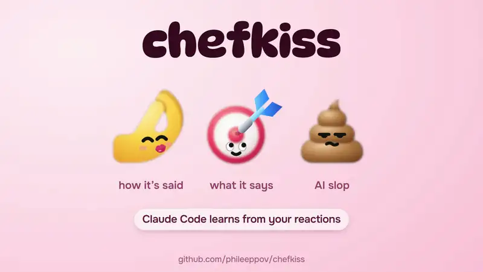

<p align="center"></p>

<h1 align="center">chefkiss</h1>

<p align="center">A 💩 button for AI slop. Claude takes the hint.</p>

<p align="center"></p>

Every answer in Claude Code gets three buttons: 🤌 for how it's said, 🎯 for what it says, 💩 for AI slop. Select a sentence first to react to that part only (in the desktop app). Claude replies to each click with a one-line takeaway, and new sessions start with your latest ones, 15 at most, in every project.

```
/plugin install chefkiss --marketplace phileeppov/chefkiss
```

Animated buttons in the desktop app, plain emoji in the terminal. The desktop app and other ways: [Install](#install).

After a few reactions, the `/chefkiss` pane can sum you up: one line about you, up to five on how you like your answers. Cross out what it got wrong and post the rest. [Forget all](#reset-or-turn-off) erases lessons, the summary, and reactions.

Why not a line in CLAUDE.md? You click in the moment instead of editing a file, you can react to a single sentence, and Claude's reply shows right away whether it understood.

Lessons are stored on your machine, and the mod doesn't save Claude's answers. There's no chefkiss server.

Each click costs one Sonnet call on your Claude Code account, about 500 tokens. Sum up is one more call, only when you press it. You can turn those calls off in Settings; details in [what gets sent where](#what-gets-sent-where).

## What it does

- **Reactions.** Under each final answer: 🤌 Chef's kiss, 🎯 Spot on, 💩 Slop. In the desktop app the row shows when you hover an answer, and hovering a button shows what it means; in the terminal the row is always there. Click a reaction again to take it back. Select part of the answer before clicking to react to that part (desktop app, or the terminal in fullscreen mode).
- **💩 is for how it sounds.** If the answer is wrong, tell Claude in the chat. Your first 💩 brings a one-time hint about this.
- **Swap the emoji.** In `/chefkiss` → Buttons you can put ❤️ on the first button, 🔥 on the second and 🤖 on the third. What the buttons mean and what Claude is told stay the same.
- **Claude's line.** Claude answers each reaction with one short line, "got it: …", in Russian when the answer is in Russian and in English otherwise. With a mouse, hover the reaction to read it again; elsewhere it shows for a few seconds and then lives in the pane. That line is the lesson.
- **Lessons in new conversations.** Each new conversation starts with your 15 latest lessons, or with a short summary and the lessons that came after it. Lessons are shared by all your projects: one learned in one repository goes into new conversations everywhere.
- **The pane.** `/chefkiss` opens it: what each reaction means, About you (the summary), Lessons, the icon pack, the pictures on the buttons and Settings.
- **The summary, to keep or post.** **Sum up** in About you turns your lessons into one line about you and up to five lines on how you like answers. **Post on X** opens a new post with the line about you, the lines that fit in 280 characters and a link to the mod; you post it or close it. **Copy** puts all of it on the clipboard. New conversations get the lines, not the line about you.

The mod drops a line with a link, a slash or a backtick in it (paths and commands look like that), or one that repeats five words in a row from the answer, so it never becomes a lesson.

## Install

At the prompt of a Claude Code terminal session:

```
/plugin install chefkiss --marketplace phileeppov/chefkiss
```

Answer `y` to add the marketplace, then pick the user scope so the mod also loads in the desktop app. From a shell, the same is `claude plugin install chefkiss --marketplace phileeppov/chefkiss`. In the desktop app: click + next to the prompt box, then Add plugins (or Plugins, then Browse plugins). In the plugin browser, click + (Add marketplace), choose Add from a repository, enter `phileeppov/chefkiss` and click Sync. Then click + on chefkiss. Typing `/plugin` opens Settings → Plugins, where Add → Add marketplace leads to the same window.

Organizations that allow only managed mods (`allowManagedModsOnly`) or only managed hooks (`allowManagedHooksOnly`) will not load it.

To update: `claude plugin update chefkiss@phileeppov`, with the same `--scope` you installed it with, then restart Claude Code.

## What gets sent where

Three things, all text. Apart from them the mod sends nothing anywhere: it makes no network requests of its own.

**A note on your next message.** Reactions you left or took back since your last message ride along with it as hidden context: the reaction, the first 90 characters of the answer, the part you selected (up to 160 characters) and Claude's line if it is ready, plus a short instruction not to overcorrect or bring the reactions up unasked. Up to about 950 characters for the first reaction and about 400 for each one after it. It goes once, and never on messages from schedules, notifications, other sessions or other mods.

**A digest at the start of each new conversation.** Your 15 latest lessons, up to about 2,200 characters, or the summary with up to five newer lessons, up to about 1,500. A lesson repeated word for word takes one line with a count, so the 15 are 15 different lessons. It comes once per conversation, and again after a compaction or `/clear`. Runs with nobody at the prompt (`claude -p`, CI) get none, and the system prompt is left alone. Subagents get it too, as the start of a conversation of their own: the mod cannot tell them apart, so an agent that searches code also reads your lessons about tone.

**The mod's own model calls**, on your Claude Code account like any other request:

- Each reaction is one call to Sonnet, plus one to Haiku if Sonnet does not answer. If the line fails the check above, the mod asks once more and says why. Each call sends the answer, up to 1,200 characters (a longer one as its first 800 and its last 400), and the selected part (up to 300); the second one also carries the refused line and the reason. That is up to about 500 input tokens per call for English and 800 for Russian (a little more for the second), estimated from the character count, and up to 120 output tokens.
- **Sum up** in the pane is one call to Sonnet over all your lessons (plus one to Haiku if Sonnet does not answer), only when you press it. At the 300-lesson cap that is up to about 32,000 characters in (about 7,500 tokens for English, more for other languages) and up to 400 tokens out.

Turning off **Claude writes lessons** in Settings stops both calls. Reactions still reach Claude as the note above. Claude writes no new lines, lessons or summary; the ones you already have keep going into new conversations until you turn off **Lessons in new chats** too.

## Where it's stored

Everything the mod keeps lives in one JSON file of its own, `~/.claude/plugins/store/chefkiss_*.json`:

- lessons: the line, the reaction, when, the project folder's name, the session id and the message id; the newest 300 are kept;
- reactions per session, so the icons survive a restart: which reaction sits on which message and Claude's line, with no text from the answers; kept for 60 days;
- the summary and the 20 latest lines you crossed out of it (so **Update** does not bring them back), your settings, whether you have seen the 💩 hint, and when you last forgot everything or which reactions you forgot one by one, so open conversations catch up.

The note rides inside your message, so the conversation keeps it like the rest of what you sent.

**Journal folder** in Settings also writes the lessons into one Markdown file per month, `Reactions YYYY.MM.md`. The file is rebuilt from the store on every change, so edits made by hand are lost.

In that field `~` means your home folder, and a relative path lands inside the current project. Leave it empty to stop the journal.

## Reset or turn off

- One lesson: × next to it in Lessons. It takes the reaction off its answer too: at once in this conversation, within a few seconds in another open one (in the app or a terminal), and in a background run (`claude -p`) on its next message or when it next starts. The pane lists the 8 latest; older ones go only with **Forget all**. Taking a reaction back removes its lesson too.
- A wrong line in the summary, or the line about you: × next to it. **Update** is told not to write it again.
- Everything: **Forget all**, pressed twice. It erases every lesson, the summary with the lines you crossed out of it, and the reactions under answers with Claude's lines, in all sessions: an open conversation (in the app or a terminal) drops them within a few seconds, a background run (`claude -p`) on its next message. What Claude already got in a conversation stays in it.
- New conversations without lessons: turn off **Lessons in new chats**.
- No model calls: turn off **Claude writes lessons**.
- The whole mod: `claude plugin uninstall chefkiss@phileeppov` in a terminal, with `--scope project` or `--scope local` if you installed it there. If `~/.claude/plugins/store/chefkiss_*.json` is still there afterwards, delete it, along with the journal folder if you set one.

## Requirements

Claude Code with mods. Tested on 2.1.309 and 2.1.317. On 2.1.295 the tests pass except the pane's, which fake a newer engine; there the pane draws its text in one size.

The desktop app draws the animated icons. The terminal cannot draw them: there the reactions are plain buttons with emoji, and the Kaomoji pack in `/chefkiss` → Pack swaps them for text faces. Outside fullscreen mode the mod cannot see what you select, so a reaction goes on the whole answer. 🤌 joined emoji in 2020, so an older terminal font may show a box in its place. VS Code and the phone app have not been checked by eye.

## Development

```
claude plugin test .
claude plugin validate .
```

On engines before 2.1.308 the pane tests fail, because the test world reports 2.1.309.

## License

MIT. Not affiliated with Anthropic.

Made by [@phileeppov](https://x.com/phileeppov).
